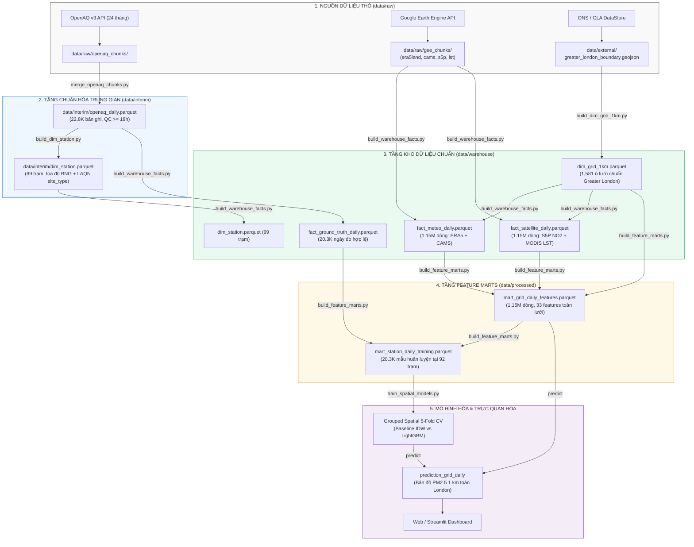

# London PM2.5 Spatial Estimation Warehouse & Analytics Pipeline

> Hệ thống Kho dữ liệu Không gian - Thời gian (Spatio-temporal Warehouse) nhiều tầng (`raw` → `interim` → `warehouse` → `processed`), tích hợp dữ liệu quan trắc trạm mặt đất, tái phân tích khí quyển (ERA5-Land), viễn thám vệ tinh (Sentinel-5P, CAMS, MODIS) và đặc trưng đô thị nhằm ước lượng nồng độ bụi mịn $\text{PM}_{2.5}$ trung bình ngày trên toàn bộ lưới 1 km của vùng Greater London.

* **Chủ đề nghiên cứu:** Ước lượng bề mặt nồng độ ô nhiễm bụi mịn $\text{PM}_{2.5}$ hồi cứu/đồng thời trên toàn Greater London, giải quyết bài toán mạng lưới quan trắc mặt đất bị thưa thớt và phân bố lệch không gian.
* **Tài liệu nghiệp vụ & bài toán:** [docs/business_case.md](docs/business_case.md)
* **Kế hoạch thực nghiệm & kiểm định (Q1–Q5):** [docs/analysis_plan.md](docs/analysis_plan.md)
* **Hợp đồng dữ liệu:** [docs/data_contract.md](docs/data_contract.md)
* **Đặc tả cấu trúc Warehouse:** [docs/schema.md](docs/schema.md)
* **Nhật ký kiến trúc:** [docs/decison_log.md](docs/decison_log.md) · [docs/architecture.md](docs/architecture.md)

---

## Các mốc tiến độ dự án (Milestones)

| Mốc | Nội dung chi tiết | Trạng thái | Phụ trách chính |
| :---: | :--- | :---: | :--- |
| **M1** | **Khung kiến trúc & Hợp đồng dữ liệu:** Cấu trúc thư mục, môi trường, thiết kế Data Contract, Schema Specification, nguyên tắc chống rò rỉ dữ liệu (Spatial Data Leakage). | ✅ | Data Architect |
| **M2** | **Thu thập & Chuẩn hóa dữ liệu trạm quan trắc:** Crawler OpenAQ v3 API, gán metadata và phân loại loại trạm (`site_type`) từ mạng lưới LAQN, đối soát tọa độ British National Grid (EPSG:27700). | ✅ | Crawler A, Quality |
| **M3** | **Xây dựng Lưới chuẩn không gian Greater London:** Chuẩn hóa `dim_grid_1km` chuẩn 1,581 ô (lọc theo ranh giới ONS/GLA, bảo tồn trạm ngoại vi, tính khoảng cách Charing Cross, loại bỏ ~1,640 ô thừa ngoài phạm vi). | ✅ | Data Architect, Transform |
| **M4** | **Trích xuất Viễn thám & Dựng Fact Warehouse:** Trích xuất GEE 24 tháng (ERA5-Land, CAMS, Sentinel-5P, MODIS LST). Dựng Fact Warehouse chuẩn hóa (`fact_meteo_daily`, `fact_satellite_daily`, `fact_ground_truth_daily`). | ✅ | Crawler B, Data Architect |
| **M5** | **Xây dựng Feature Marts & Tập huấn luyện:** Dựng spine không gian `(grid_id, date)` (`mart_grid_daily_features` 1.15M dòng) và tập huấn luyện tại trạm `(station_key, date)` (`mart_station_daily_training` 20K dòng). | ✅ | Transform, Data Architect |
| **M6** | **Mô hình hóa & Đánh giá Không gian (Spatial CV):** Phân chia 5 cụm trạm không giao nhau (Grouped Spatial 5-Fold), xây dựng baseline IDW / Spatial Mean, huấn luyện LightGBM/CatBoost, thực nghiệm Q1–Q5. | 🔵 Đang làm | Analysis & Modeling |
| **M7** | **Bản đồ Ước lượng Toàn thành phố & Dashboard:** Sinh bản đồ raster $\text{PM}_{2.5}$ 1 km toàn Greater London kèm khoảng bất định, xây dựng Dashboard báo cáo sức khỏe dữ liệu và phân tích. | ⏳ | Dashboard & Viz |

---

## Hướng dẫn chạy hệ thống (Quickstart)

### 1. Chuẩn bị môi trường
Dự án yêu cầu **Python 3.10+**. Khuyến nghị sử dụng môi trường ảo (`venv`):

```bash
# Clone repository
git clone https://github.com/NguyenThinh06/pm25_london.git
cd pm25_london

# Tạo và kích hoạt virtual environment
python -m venv .venv
source .venv/bin/activate        # Linux/macOS
.venv\Scripts\activate           # Windows PowerShell

# Cài đặt các thư viện cần thiết
pip install pandas numpy pyarrow pyproj geopandas pyogrio requests earthengine-api lightgbm scikit-learn
```

### 2. Thiết lập cấu hình (.env)
Sao chép file mẫu và cấu hình API key cần thiết:
```bash
cp .env.example .env
```
Điền các giá trị vào `.env`:
* `OPENAQ_API_KEY`: API Key lấy từ trang [OpenAQ Developer Portal](https://openaq.org/).
* `GEE_PROJECT_ID`: Tên Google Cloud Project đã kích hoạt Earth Engine API.

### 3. Quy trình chạy Pipeline từng bước

```bash
# BƯỚC 1: Xây dựng bảng chiều không gian chuẩn dim_grid_1km (1,578 ô Greater London)
python scripts/build_dim_grid_1km.py --download-boundary

# BƯỚC 2: Thu thập và chuẩn hóa danh mục trạm quan trắc dim_station
python scripts/build_dim_station.py

# BƯỚC 3: Trích xuất dữ liệu khí quyển & viễn thám từ GEE (chạy chunk theo tháng)
python scripts/extract_gee_features.py era5land cams --start 2023-01 --end 2024-12
python scripts/extract_gee_features.py s5p --start 2023-01 --end 2024-12

# BƯỚC 4: Hợp nhất Fact bảng Warehouse và dựng Feature Mart
python scripts/build_warehouse_facts.py
python scripts/build_feature_marts.py

# BƯỚC 5: Huấn luyện Baseline & Mô hình Spatial CV (5-Fold)
python scripts/train_spatial_models.py
```

---

## Sơ đồ Đường ống Dữ liệu (End-to-End Pipeline)

Hệ thống xử lý luồng dữ liệu 5 tầng từ nguồn thô đến mô hình hóa và trực quan hóa:



---

## Kiến trúc Kho Dữ liệu & Quy tắc Luồng dữ liệu

```text
pm25_london/
├── data/
│   ├── raw/                # Dữ liệu gốc bất biến: JSON API OpenAQ, chunk parquet thô từ GEE
│   ├── interim/            # Dữ liệu chuẩn hóa trung gian: dim_station, openaq_daily
│   ├── external/           # Ranh giới hành chính ONS/GLA (.geojson), lưới nền thô
│   ├── warehouse/          # Kho dữ liệu chuẩn hóa: dim_grid_1km, dim_station, fact_*
│   └── processed/          # Feature Marts phục vụ mô hình: mart_grid_daily_features, mart_station_training
├── docs/                   # Tài liệu thiết kế kiến trúc, hợp đồng dữ liệu, schema, nhật ký
├── scripts/                # Entrypoints thực thi từng bước trong pipeline
├── src/                    # Source code module hóa (ingest, features, models, viz)
├── models/                 # Model artifacts đã train và metadata
└── reports/                # Báo cáo thực nghiệm, bảng chỉ số, bản đồ dự đoán
```

### 4 Nguyên tắc cốt lõi của Kiến trúc:
1. **Raw data bất biến:** Mọi response từ OpenAQ v3 và GEE đều được lưu bản thô nguyên gốc trong `data/raw/` để đảm bảo khả năng tái lập và kiểm toán dữ liệu.
2. **Grain độc lập, không gán nhãn sai lệch:**
   * **Nhãn quan trắc:** Grain là `(station_key, date)` trong `fact_ground_truth_daily`. Không ép nhãn trạm làm đại diện tuyệt đối cho toàn bộ ô lưới $1\text{ km}^2$.
   * **Feature không gian:** Grain là `(grid_id, date)` trong `mart_grid_daily_features`.
   * **Dự đoán mô hình:** Grain là `(run_id, grid_id, date)` kèm khoảng bất định.
3. **Cổng kiểm soát chất lượng (Quality Gate):** Bản ghi ngày chỉ được đánh dấu `is_valid_day = 1` khi số giờ đo hợp lệ trong ngày $\ge 18\text{h}$ ($\ge 75\%$).
4. **Đánh giá Spatial Holdout nghiêm ngặt:** Chia 5 fold theo cụm địa lý của trạm (Grouped Spatial Split), tuyệt đối không dùng Random Split hay Time-series Split ngẫu nhiên trên cùng không gian để tránh rò rỉ thông tin không gian (Spatial Leakage).

---

## Phân công Nhiệm vụ & Vai trò trong Nhóm

Mỗi thành viên sở hữu không gian làm việc (workspace) của mình. Chỉnh sửa ngoài phạm vi sở hữu cần trao đổi và được duyệt bởi chủ sở hữu thông qua Pull Request.

| # | Vai trò (Role) | Người thực hiện | Không gian sở hữu (Workspace) | Nhãn Issue | Nhánh Git |
| :-: | :--- | :---: | :--- | :---: | :---: |
| **1** | **Data Architect & Integration Owner** | **Đ** | `docs/schema.md`, `docs/data_contract.md`, `docs/architecture.md`, `docs/decison_log.md`, `scripts/build_dim_grid_1km.py`, `data/warehouse/` | `role:architect` | `arch/…` |
| **2** | **Analysis Lead & Quality Owner** | *[Họ tên]* | `docs/business_case.md`, `docs/analysis_plan.md`, các tiêu chí QC trạm, kiểm định giả thuyết Q1–Q5 | `role:quality` | `quality/…` |
| **3** | **Source & Crawler A (Ground Truth)** | *[Họ tên]* | `scripts/fetch_openaq.py`, `scripts/merge_openaq_chunks.py`, `data/raw/openaq_*`, chuẩn hóa nhãn trạm | `role:crawler-a` | `ingest/openaq…` |
| **4** | **Crawler B & Remote Sensing (GEE)** | *[Họ tên]* | `scripts/extract_gee_features.py`, pipeline Google Earth Engine (ERA5-Land, CAMS, S5P, MODIS) | `role:crawler-b` | `ingest/gee…` |
| **5** | **Transform & Feature Engineering** | *[Họ tên]* | `src/features/`, dựng `mart_grid_daily_features`, `mart_station_daily_training`, trích xuất biến tĩnh không gian | `role:transform` | `transform/…` |
| **6** | **Analysis & Spatial Modeling** | *[Họ tên]* | `src/models/`, Spatial 5-Fold Grouped CV, Baseline IDW, LightGBM/CatBoost, thực nghiệm Q1–Q5 | `role:analysis` | `model/…` |
| **7** | **Dashboard & Visualization** | *[Họ tên]* | `src/viz/`, `app/`, xây dựng bản đồ nồng độ PM2.5 toàn thành phố, trực quan hóa sức khỏe pipeline | `role:dashboard` | `viz/…` |

---

## Chi tiết Công việc theo Từng Vai trò

### 1. Data Architect & Integration Owner (Kiến trúc & Tích hợp)
* **Mục tiêu:** Đảm bảo toàn bộ kho dữ liệu nhất quán về cấu trúc, hệ quy chiếu không gian (CRS), hợp đồng dữ liệu và có thể tái tạo hoàn toàn từ đầu.
* **Công việc đã hoàn thành & đang phụ trách:**
  * ✅ Thiết kế toàn bộ quy chuẩn kho dữ liệu trong [docs/schema.md](docs/schema.md) và hợp đồng dữ liệu trong [docs/data_contract.md](docs/data_contract.md).
  * ✅ Chuẩn hóa hệ tọa độ dự án sang **British National Grid (EPSG:27700)**, khớp với chuẩn khảo sát Vương quốc Anh.
  * ✅ Tái cấu trúc và tối ưu hóa lưới không gian: Thay thế lưới chữ nhật bounding-box thô (3,224 ô) bằng quy trình clip không gian chính xác theo ranh giới Greater London của ONS/GLA, giảm còn **1,578 ô** (1,577 ô nội bộ + 1 ô trạm Dartford ngoại vi), tiết kiệm 50% chi phí tính toán và lưu trữ.
  * ✅ Giữ cấu trúc thư mục phân tầng sạch sẽ, điều phối tích hợp giữa các nhánh, duyệt PR liên quan tới schema warehouse và hợp đồng dữ liệu.
* **Định nghĩa hoàn thành:** Toàn bộ pipeline từ raw đến warehouse chạy tự động, không lỗi xung đột khóa, dữ liệu đúng grain và không rò rỉ không gian.

### 2. Analysis Lead & Quality Owner (Phân tích Nghiệp vụ & Chất lượng)
* **Mục tiêu:** Đảm bảo dữ liệu đầu vào đạt chuẩn chất lượng khoa học và các kết quả mô hình giải quyết đúng câu hỏi nghiên cứu.
* **Nhiệm vụ chính:**
  * Soạn thảo và bảo vệ [docs/business_case.md](docs/business_case.md) và [docs/analysis_plan.md](docs/analysis_plan.md).
  * Thiết lập cổng kiểm soát chất lượng (QC gate): Quy định ngưỡng trích lọc bản ghi hợp lệ ($\ge 18\text{h}$ quan trắc trong ngày, kiểm tra outlier bất thường).
  * Duyệt kết quả kiểm định 5 câu hỏi nghiên cứu (Q1–Q5) và nghiệm thu độ tin cậy của mô hình trên các trạm held-out.

### 3. Source & Crawler A (Thu thập Dữ liệu Trạm Mặt đất)
* **Mục tiêu:** Thu thập đầy đủ dữ liệu đo đạc thực tế của các trạm quan trắc mặt đất tại London, lưu vết xuất xứ (lineage).
* **Nhiệm vụ chính:**
  * Hoàn thiện script thu thập OpenAQ v3 API (`fetch_openaq.py`) với cơ chế rate-limit và retry an toàn.
  * Đối soát metadata vị trí trạm và gán nhãn phân loại trạm (`site_type`: Roadside, Urban Background, Suburban) qua LAQN API.
  * Sinh dữ liệu interim `dim_station.parquet` và `openaq_daily.parquet`.

### 4. Crawler B & Remote Sensing (Khai thác Viễn thám & Tái phân tích Khí quyển)
* **Mục tiêu:** Trích xuất các biến khí tượng và viễn thám vệ tinh từ Google Earth Engine tương ứng với từng ô lưới 1 km.
* **Nhiệm vụ chính:**
  * Chạy trích xuất tự động theo chunk tháng cho ERA5-Land (nhiệt độ, độ ẩm, gió, mưa, áp suất, độ cao lớp biên BLH).
  * Trích xuất CAMS NRT (AOD 550nm, PM2.5 nền) và Sentinel-5P TROPOMI ($\text{NO}_2$, tỷ lệ mây).
  * Đảm bảo mọi chunk parquet xuất ra chuẩn tên cột theo [docs/schema.md](docs/schema.md).

### 5. Transform & Feature Engineering (Chuyển đổi & Kỹ thuật Đặc trưng)
* **Mục tiêu:** Biến đổi các bảng raw/interim thành các bảng Fact và Feature Marts chuẩn bị cho bước huấn luyện.
* **Nhiệm vụ chính:**
  * Hợp nhất các chunk GEE theo danh sách ô lưới của `dim_grid_1km` để tạo `fact_meteo_daily` và `fact_satellite_daily`.
  * Dựng spine không gian-thời gian `mart_grid_daily_features` (tích Descartes giữa lưới và lịch quan trắc).
  * Ghép nhãn thực tế để tạo `mart_station_daily_training`.

### 6. Analysis & Spatial Modeling (Mô hình hóa & Đánh giá)
* **Mục tiêu:** Huấn luyện các mô hình ước lượng không gian PM2.5 và đánh giá độ chính xác theo chuẩn khoa học.
* **Nhiệm vụ chính:**
  * Thiết lập Grouped Spatial 5-Fold Cross Validation theo cụm trạm.
  * Xây dựng các mô hình nền tảng (Baselines): Spatial Mean, Inverse Distance Weighting (IDW).
  * Huấn luyện mô hình Gradient Boosting (LightGBM / CatBoost), tối ưu siêu tham số bên trong từng fold.
  * Đo lường các chỉ số MAE, RMSE, Spatial $R^2$, Temporal $R^2$ và thực hiện ablation study theo kế hoạch Q1–Q5.

### 7. Dashboard & Visualization (Trực quan hóa & Ứng dụng)
* **Mục tiêu:** Trực quan hóa kết quả ước lượng toàn thành phố và cung cấp giao diện theo dõi tiến độ/chất lượng dữ liệu.
* **Nhiệm vụ chính:**
  * Xây dựng module render bản đồ nồng độ PM2.5 độ phân giải 1 km cho toàn bộ Greater London.
  * Thiết kế giao diện Dashboard (Streamlit / Web) hiển thị: Bản đồ nhiệt ô nhiễm theo ngày, biểu đồ phân tích chuỗi thời gian, độ bất định của mô hình và sức khỏe của pipeline dữ liệu.

---

## Quy trình Làm việc với Git & Pull Request

1. **Nhận nhiệm vụ:** Vào tab **Issues**, lọc theo nhãn vai trò của mình (ví dụ `role:crawler-a`, `role:transform`, `role:architect`), tự gán issue cho bản thân.
2. **Tạo nhánh:** Tạo nhánh từ `main` mới nhất theo cú pháp: `<vai-tro>/<ten-tinh-nang>`:
   ```bash
   git switch main && git pull
   git switch -c ingest/gee-s5p-pipeline
   ```
3. **Mở Pull Request:** Sau khi hoàn thành và tự kiểm tra, tạo PR vào nhánh `main`. Trong mô tả PR ghi rõ `Closes #<so-issue>`.
4. **Điều kiện Merge:**
   * Mọi PR liên quan đến cấu trúc `data/warehouse/` hoặc `schema.md` phải được duyệt bởi **Data Architect**.
   * Mọi PR liên quan đến logic đánh giá mô hình và báo cáo thống kê phải được duyệt bởi **Analysis Lead**.
   * Đảm bảo code chạy đúng, sạch sẽ và không commit dữ liệu thô nhạy cảm lên Git.

1. **Nhận nhiệm vụ:** Vào tab **Issues**, lọc theo nhãn vai trò của mình (ví dụ `role:crawler-a`, `role:transform`, `role:architect`), tự gán issue cho bản thân.
2. **Tạo nhánh:** Tạo nhánh từ `main` mới nhất theo cú pháp: `<vai-tro>/<ten-tinh-nang>`:
   ```bash
   git switch main && git pull
   git switch -c ingest/gee-s5p-pipeline
   ```
3. **Mở Pull Request:** Sau khi hoàn thành và tự kiểm tra, tạo PR vào nhánh `main`. Trong mô tả PR ghi rõ `Closes #<so-issue>`.
4. **Điều kiện Merge:**
   * Mọi PR liên quan đến cấu trúc `data/warehouse/` hoặc `schema.md` phải được duyệt bởi **Data Architect**.
   * Mọi PR liên quan đến logic đánh giá mô hình và báo cáo thống kê phải được duyệt bởi **Analysis Lead**.
   * Đảm bảo code chạy đúng, sạch sẽ và không commit dữ liệu thô nhạy cảm lên Git.

